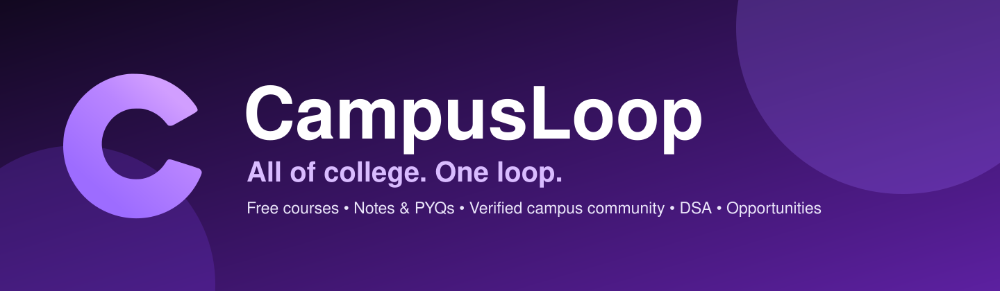

<!--
  CampusLoop — GitHub organization profile
  Metadata (set in Organization settings → Profile, mirrored in ../BRAND.md):
  Name:        CampusLoop
  Description: All of college. One loop. Free courses, notes, PYQs, a verified campus
               community, DSA prep and student opportunities for 1,400+ Indian colleges.
  Website:     https://campusloop.space
  Location:    India
  Avatar:      profile/assets/avatar.png (in this repo)
-->

  

  
  
  
  

## 👋 What is CampusLoop?

**CampusLoop is the home of college life online** — free courses, peer notes and solved PYQs, and a **verified-students-only** campus community for **1,400+ Indian colleges**. One college-email sign-in keeps your campus feed, your learning and your streak in one loop.

- 🎓 **Learn free** — courses from Harvard (CS50), MIT, NPTEL and India's best teachers, with certificates
- 📚 **Study smarter** — peer notes, solved previous-year questions (PYQs) and an academic vault for your university
- 🗣️ **Your campus, unfiltered** — feeds, confessions, polls, stories, chats and college hubs, gatekept by verified student email
- 💼 **Get placed** — DSA prep, interview patterns and a live board of internships, hackathons, scholarships and fellowships

  <a href="https://campusloop.space"><strong>🌐 Join free at campusloop.space →</strong></a>
  &nbsp;·&nbsp;
  <a href="https://campusloop.space/demo"><strong>🔑 Try the live demo →</strong></a>

---

## 🚀 The CampusLoop ecosystem

| Product | What it does | Live | Code |
|---|---|---|---|
| **CampusLoop** | The main app — verified campus social network + free courses, notes & PYQs for 1,400+ colleges | [campusloop.space](https://campusloop.space) | [playlikeboy/campusloop](https://github.com/playlikeboy/campusloop) |
| **DSALoop** | Master DSA & coding interviews — patterns, roadmaps, Blind 75 / Grind 169, online judge & compiler, 28-chapter system-design primer | [dsaloop.campusloop.space](https://dsaloop.campusloop.space) | [campusloop-space/dsaloop](https://github.com/campusloop-space/dsaloop) |
| **Opportunities** | Internships, hackathons, scholarships & fellowships for students — with the deadlines that matter | [opportunities.campusloop.space](https://opportunities.campusloop.space) | [campusloop-space/opportunities](https://github.com/campusloop-space/opportunities) |
| **Articles** | Long-form guides on placements, GATE, scholarships, internships & campus life | [campusloop.space/articles](https://campusloop.space/articles) | — |

> One loop, not separate islands: progress on DSALoop and deadlines on Opportunities feed back into your CampusLoop streak and Loop Points.

## 🛠️ Built with

  
  
  
  

## 📖 Start here

- 📰 **Students:** start with the [articles hub](https://campusloop.space/articles) — placements, exams, scholarships and free tools, explained step by step
- 🧑‍💻 **Developers:** browse the repos above — DSALoop is fully open in this org
- 🤝 **Colleges & communities:** reach us through [campusloop.space](https://campusloop.space)

## 🤝 Contributing

Found a bug, a wrong deadline or a broken explanation? Open an issue in the relevant repo — that's the fastest way to help every student who lands on that page after you. Please don't post assignment answers, leaked papers or others' copyrighted content.

## 🔗 Find us

- 🌐 [campusloop.space](https://campusloop.space)
- 📸 Instagram — [@campusloop.space](https://www.instagram.com/campusloop.space/)
- 💼 LinkedIn — [CampusLoop](https://www.linkedin.com/company/mycampusloop/)
- 🚀 Product Hunt — [CampusLoop](https://www.producthunt.com/products/campusloop)

  
   
  <strong>CampusLoop</strong> — All of college. One loop. Made for students, in India 🇮🇳

